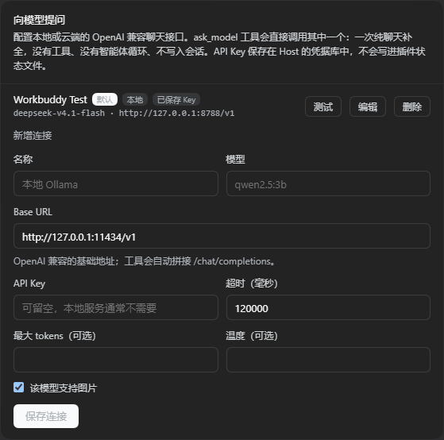

# dsh-toolset

A [DeepSeek Harness](https://github.com/deepseek-ai/deepseek-harness) plugin that bundles several small
features, each with an independent switch under **Settings → Toolset**, and ships the
**PTC + 创造 (PTC + Creator)** Agent preset.


## Features

| id | Feature | Default |
| --- | --- | --- |
| `request-status` | Live session status under the composer: 就绪 / 错误 / 进行中·请求 / 等待回复 / 思考 / 等待工具 / 输出 | on |
| `safe-restart` | The `dsh_safe_restart` tool: restarts the Desktop app after the Host is idle, then resumes the session and continues automatically | on |
| `rewind` | A rewind action beside Copy on every user message: continue from before that message in a new branch (workspace unchanged; the original session is archived and restorable) | on |
| `prompt-tuning` | Settings editor that starts from an existing Agent preset, edits its opening identity line and initial system prompt, and saves the result as a new preset (live, no restart) | on |
| `ask-model` | The `ask_model` tool plus a Settings editor for local/cloud OpenAI-compatible chat connections; the Agent can ask that chat model with file, image, audio and video attachments | on |

## Bundled preset: PTC + 创造

The plugin patch also declares one `@deepseek-ai/dsh-agent-preset` row, `ptc-cordis`,
so installing this single bundle gives you the preset as well:

| Combination | Rows |
| --- | --- |
| Creator mode | `tool-cordis` (runtime self-inspection) and `tool-plugin-manager` / `tool-plugin-market` (dynamic plugin mounting), plus the creator skills mounted through `skill-filesystem` from `@deepseek-ai/dsh-agent-preset/skills` |
| PTC mode | `tool-presentation` with `mode: ptc`: the model writes one TypeScript program executed by `run_code` instead of calling tools one by one |
| Hybrid | `workflow-ptc` / `tool-workflow` stay **enabled** (the shipped `ptc` preset disables them), because JS orchestration and PTC are complementary |

Everything else matches the shipped `cordis` preset. It is inserted rather than
overriding `preset-cordis`, so the four shipped presets stay intact and this one is an
extra roster entry (order 5). Turn the whole preset off from a higher patch layer:

```yaml
- id: preset-ptc-cordis
  name: '@deepseek-ai/dsh-agent-preset'
  disabled: true
```

The patch is `cordis.patch.yml` in this package; `node qa/validate-bundle-patch.mjs`
(developer-only) re-parses it and checks every row. New sessions pick it in
**Settings → Agent presets** or from the new-task preset picker.

## Layout

| File | Role |
| --- | --- |
| `index.js` | Host entry: feature API, feature-gated Host features, post-restart resume pass |
| `client.js` | Client entry: Settings → Toolset switch page + prompt-tuning editor, request-status pill, user-message rewind action |
| `lib/features.js` | Feature ids and defaults |
| `lib/prompt-tuning.js` | Agent-preset persona/identity editing, profile-patch declaration, live HMR apply/rollback |
| `lib/preset-identity.js` | Preset-mountable row that shadows DSH's fixed `harness:identity` system-prompt line |
| `lib/ask-model.js` | `ask_model` tool, OpenAI-compatible chat client, image/audio/video attachment loading, connection validation |
| `lib/tool.js` | `dsh_safe_restart` tool definition |
| `lib/restart.js` | Idle-gated restart scheduler, armed request marker, detached helper launch |
| `lib/resume.js` | Post-restart session resume + continuation message |
| `restart-helper.ps1` | Detached PowerShell helper that terminates the Electron tree and relaunches the app |
| `cordis.patch.yml` | Bundle patch: the `dsh-toolset` plugin row plus the `preset-ptc-cordis` Agent-preset row |
| `test/` | Dependency-free unit tests (`node --test`) |

## Feature 1: request status

The status widget derives its phase only from data the Web client already
holds: the Session snapshot (`running`, `lastAgentError`, `promptError`) and
the Chat snapshot (live assistant blocks, running tool calls, and the durable
Turn/Step timeline). It never polls the Host.

| Phase | Signal |
| --- | --- |
| 就绪 (ready) | not running, no live/turn error |
| 错误 (error) | not running and either a live agent/prompt error or the last Turn ended with `reason.kind === "error"` |
| 进行中·请求 (requesting) | running, no open Step yet (the next request is being prepared or sent) |
| 进行中·等待回复 (waiting for reply) | running, open Step, no live token yet |
| 进行中·思考 (thinking) | the running assistant step streams reasoning text |
| 进行中·等待工具 (waiting for tools) | a tool call is being emitted or executed |
| 进行中·输出 (output) | the running assistant step streams answer text |

## Feature 2: safe restart

`dsh_safe_restart` is a Host tool available to the model. It exists only in
the packaged Windows Desktop profile (a plain `dsh web` process cannot relaunch
itself).

Flow:

1. The model calls `dsh_safe_restart` (optional `reason` and `resume_prompt`)
   near the end of a turn.
2. The Host writes `restart-request.json` (unarmed) and waits until **every**
   Agent, queued inbox message, and background job is idle for a quiet window.
3. The Host arms the request (`armed: true`, plus the Electron main PID and
   executable path) and creates `restart-helper.ps1` through WMI
   `Win32_Process.Create`, so the helper is parented by WmiPrvSE and survives
   the Electron tree teardown. The Host waits for the helper's first log line
   and unarms the request again if the helper never starts.
4. The helper terminates the idle Electron tree and relaunches the app.
5. The new Host process claims the armed request, resumes the recorded Session
   through the Host's own `sessionController` (so Agent-preset composition and
   writer ownership stay authoritative), queues one continuation user message,
   and deletes the request.

`restart.log` in the plugin directory records both halves of the flow.

The helper uses `taskkill /PID <electron-main> /T /F` after the Host has
confirmed idleness; the desktop shell hides its window on `WM_CLOSE` instead of
quitting, so a "graceful" `taskkill` would merely hide the app.

## Feature 3: rewind to a message

Every durable user message gets a **撤回 / Rewind** action beside the host's
Copy button. Clicking it:

1. cancels the running turn, if any;
2. forks the session at the end of the **previous** completed Turn (the event
   before this user message) through the official `sessions.fork` API, with an
   incremented title;
3. opens the new branch and archives the original session, so the branch reads
   as the rewound conversation while the original stays recoverable from the
   archived list;
4. leaves workspace files untouched — nothing on disk is reverted.

The user-message row is a shadowing renderer for the `conversation.chat.node`
`user` key: it reuses the host's own `conversation.chat.user.content` Factory
for the content stack and copies the host's action-row styling, so the row keeps
the native look. The rewind action is hidden when `session/fork` is not
authorized, and the whole feature is switchable under Settings → Toolset.

## Feature 4: system prompt tuning


**Settings → Toolset → System prompt tuning** starts from an existing Agent
preset, lets you edit its initial system prompt and saves the result as a new
preset:

1. the base-preset picker lists every preset the Host registry knows about
   (shipped `standard` / `ptc` / `minimal` / `cordis`, plus custom presets);
2. the editor loads that preset's `@deepseek-ai/dsh-persona` prefix — the
   persona paragraph at the very top of the system prompt — and lets you edit
   it; an optional switch makes the edited text the *complete* system prompt
   (DSH's fixed guidance and tool descriptions are then suppressed);
3. the **opening identity line** field edits the fixed first sentence DSH
   renders above the persona (`You are an AI agent powered by DeepSeek
   Harness.`). Replace it, clear it to remove the line, or leave the default to
   keep DSH's own wording. This works because the preset mounts a small row
   (`@local/dsh-toolset/preset-identity`) that registers the same
   `harness:identity` prompt section in the agent's scope, and the registry
   lets the nearest scope shadow the global one; the deployment default is
   never edited;
4. **Save as new preset** declares a new `@deepseek-ai/dsh-agent-preset` Loader
   row in the profile patch (`cordis.patch.yml`), reusing the base preset's
   whole child plugin list with only the persona (and identity) rows replaced,
   then asks HMR to recompose the profile. The new preset appears in
   **Settings → Agent presets** and can be chosen for new sessions — no restart;
5. presets created this way are listed under the editor and can be edited
   (updated in place) or deleted. The base preset is never modified, and
   sessions that already started keep the composition they were created with.

The Host half reads the base plugin list through the registry's own
`readDocument` YAML (so `!!js` conditions survive), performs only textual
surgery on the persona and identity rows, validates the resulting patch by
recomposing, and rolls the profile patch back if the new preset fails to
activate. When HMR cannot publish the change live (no HMR, or a recomposition
that itself waits for a restart) the preset stays on disk and the result
reports `restartRequired` instead of being discarded.

## Feature 5: ask a model



**Settings → Toolset → Ask a model** manages any number of OpenAI-compatible
chat endpoints — local (Ollama, LM Studio, llama.cpp, vLLM) or cloud (OpenAI,
DeepSeek, OpenRouter, …). Each connection has a name, base URL, model, optional
API key, optional token/temperature caps, and three capability flags — images,
audio and video — that gate which attachments may be sent to it. The
saved key goes to the Host credential store under
`DSH_TOOLSET_ASK_MODEL_<ID>`; it is never written to `state.json` and never
returned to the client. The **Test** button sends one tiny request and reports
the reply and latency.

The feature adds the `ask_model` tool:

| Argument | Meaning |
| --- | --- |
| `prompt` (required) | the question or instruction |
| `system` | optional system instruction for this one request |
| `connection` | connection id or display name; omit for the default |
| `attachments` | `{path}` for a workspace file (image → image part, audio → `input_audio`, video → `video_url`, text → inlined), `{url}` for an http(s) image/video, or `{kind}` to force a media kind for extensionless files |
| `max_tokens`, `temperature` | optional per-call overrides |

It performs exactly one `/chat/completions` request: no tools, no agent loop,
no session writes. Images become `image_url` parts (base64 data URLs for local
files), audio becomes `input_audio` (wav/mp3 pass through; m4a, aac, ogg, opus,
flac, amr, wma and weba are converted to mono 16 kHz mp3 with ffmpeg when it is
available), and video becomes `video_url` (local files become base64 data
URLs). Text files are wrapped in `<attachment>` blocks. Attachments are capped
at 10 MiB each and 20 per call; text is truncated at 512 KiB. A media
attachment is rejected unless the chosen connection has that capability
enabled. The tool's description lists the configured connections and their
capabilities, so it is re-registered whenever the registry changes.

## Install

The plugin is installed into a Harness profile as a local bundle. From the
directory that contains this package, run a Harness agent and call:

```text
plugin_manager install_bundle target = <absolute path to this directory>
```

Then open **Settings → Toolset** and switch each feature independently.
`state.json`, `restart-request.json`, `restart-resume-failed.json` and
`restart.log` are runtime state and are git-ignored.

System-prompt tuning writes the presets it creates into the profile's
`cordis.patch.yml` as `insert` entries marked
`# dsh-toolset preset: <id> (managed by Settings -> Toolset)`. Deleting such a
preset from the editor removes its block again; the profile patch is otherwise
left untouched.

Ask-model connections live in `state.json`; their API keys live in the Host
credential store (`.credentials.yaml`) and are removed when the connection is
deleted. Connections without a key work as-is for local servers. Converting
non-wav/mp3 audio needs `ffmpeg` on `PATH` (or `DSH_TOOLSET_FFMPEG` pointing at
the binary); wav and mp3 work without it.

## Development

Requirements: Node.js 22+ (tests only), DeepSeek Harness Desktop on Windows for
the safe-restart feature.

```text
node --test test/*.test.mjs
```

The Host half is dependency-free (standard Node built-ins only), so it can be
installed as a linked local directory.

## License

[MIT](LICENSE)
